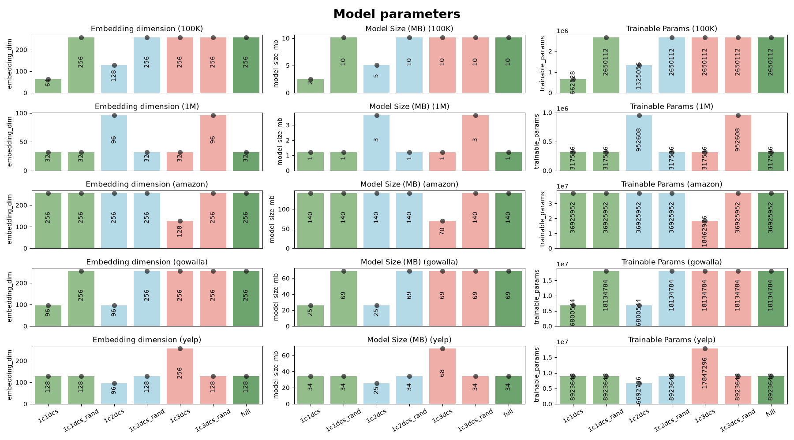
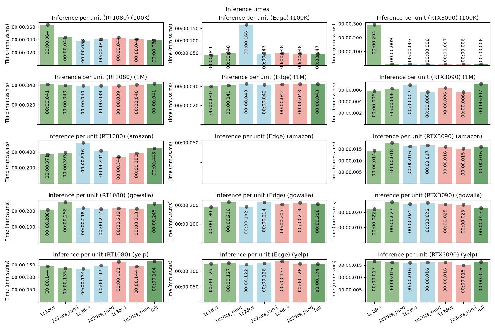
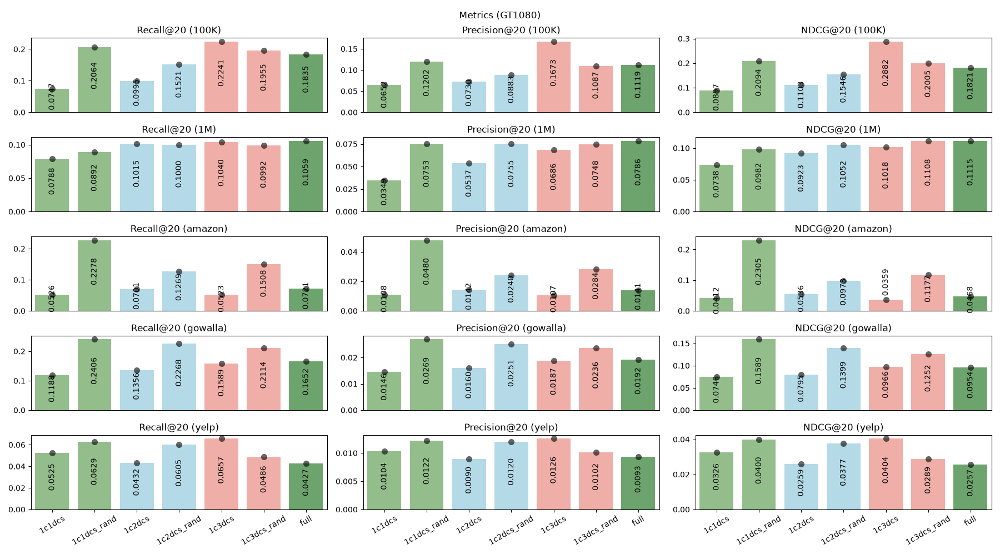
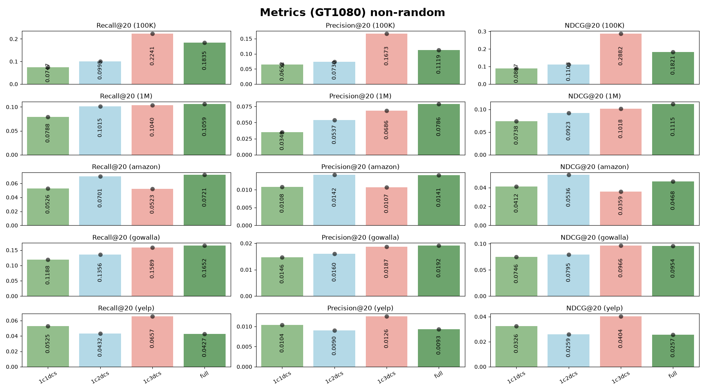
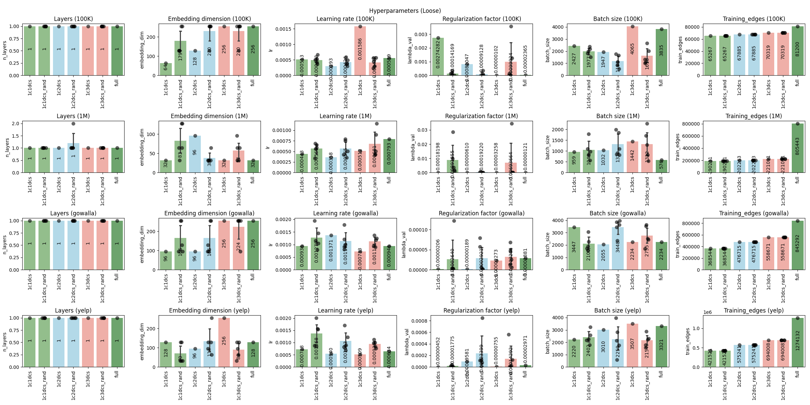
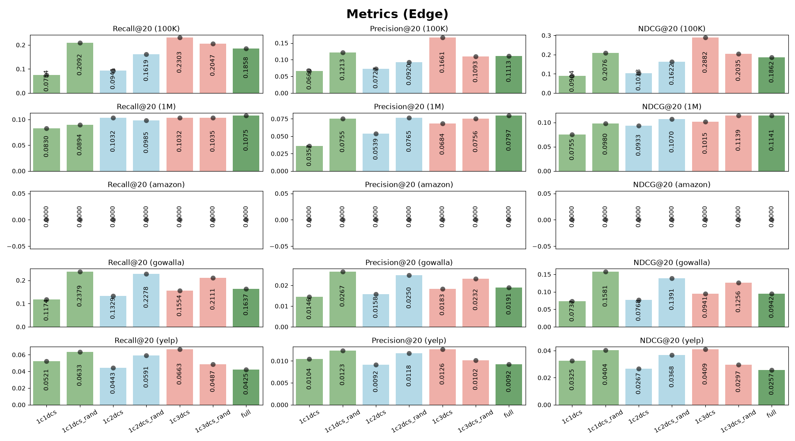
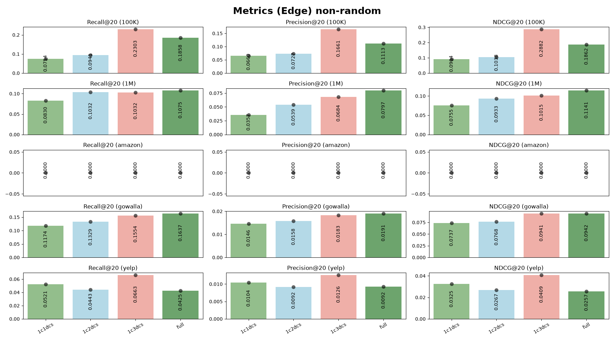
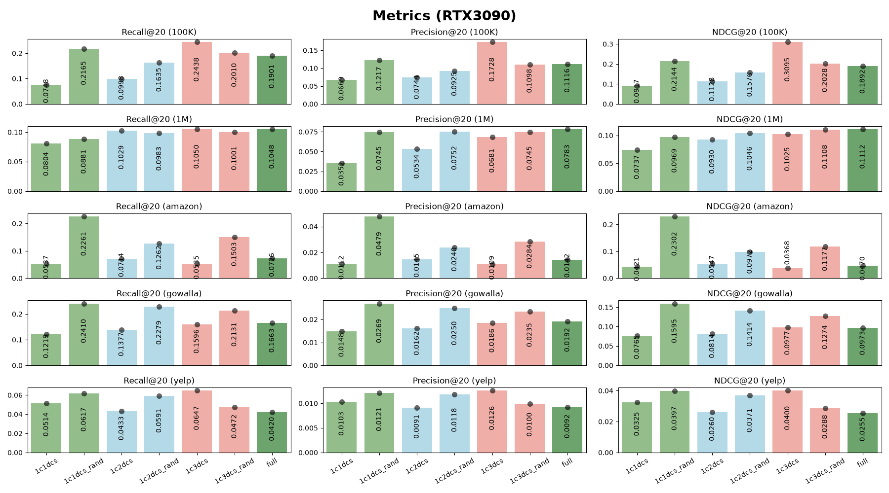
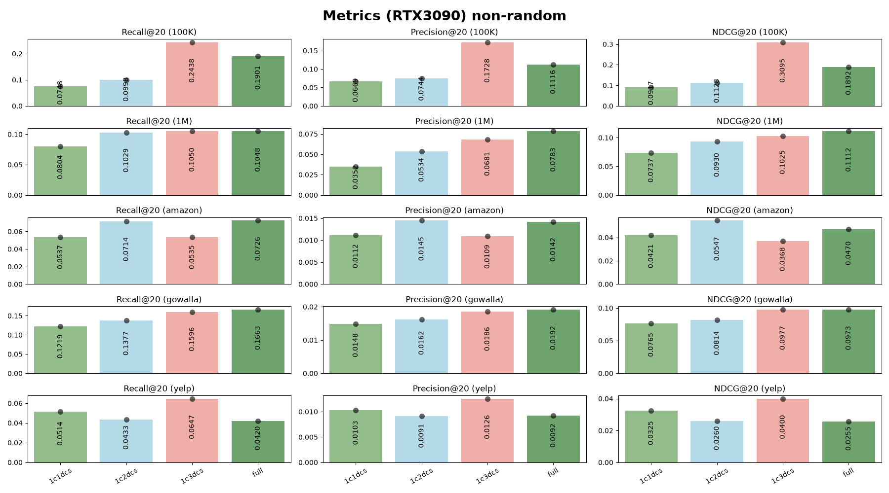

# Objective

- Experiment using a Dominant Set from a graph, to determine if we can still train and obtain comparable results to using the full data set or even a random dataset GNN

## Introduction
- Continuation from *“Sistema de recomendación basado en redes neuronales para grafos”*, Martinez, Alan (CIC)
    - Based on *“LightGCN: Simplifying and Powering Graph Convolution Network for Recommendation”*, Xiangnan, He, et. Al
- Experimentation with the impact of using Dominant Sets versus Random Sets to train a Graph NN
- MovieLens 100K and 1M input sets
- Uses LightGCN and Bayesian Personalized Ranking loss
- Original work ran 7 experiments
    - 1 Full set
    - 3 Dominant sets (1,2 and 3 dominance)
    - 3 Random equivalent
- Proved effectiveness on reduced sets

## First runs {.smaller}

### 100K Dataset

| Run | Best | Trials | Epochs | Eval<br>every | Filter | Train/test<br>split | Epoch<br>metrics | Stoppage | Optuna<br>reporting | Objective | Prunning | MOO | Dominant set<br>calculation | Models | Results|
|--|--|--|--|--|--|--|--|--|--|--|--|--|--|--|--|
|8 | * |300 | 4,000 | 50 | `eval > 0` | Structural | Yes | Early | Best  | NDCG |No|Yes| Loose/Strict | All models | Added the MOO and focused on NDCG |

### 1M Dataset

| Run | Best | Trials | Epochs | Eval every | Filter | Train/test<br>split | Epoch<br>metrics | Stoppage | Optuna<br>objective |  Objective | Prunning | MOO  | Dominant set<br>calculation | Models | Results|
|--|--|--|--|--|--|--|--|--|--|--|--|--|--|--|--|
|2 | * | 300 | 4,000 | 50 | `eval > 0` | Structural | Yes | Early | Best  | NDCG |No|Yes| Loose/Strict | All models | Added the MOO and focused on NDCG |


## Dominating Sets in GNNs

::: {.columns}
::: {.column width="50%"}

- Given a graph $G = (V,E)$, a dominant set $D \subseteq V$ is that in which every node of V \D is adjecent to at last one vertex in $D$.
- In other words, the nodes of the dominant set cover the rest of the graph nodes through their connections.
- The concept generalizes to the m-dominant set, where multi-coverage is demanded: 
    - $D$ is $m-$dominant if every node $V \setminus D$ is adjecent to at least $m$ distinct nodes in $D$.

:::

::: {.column width="50%"}

```tikz
\begin{tikzpicture}[
    % --- GENERAL STYLES ---
    % Increased minimum size slightly to nicely fit the letter labels
    user_node/.style = {circle, fill=cyan!80!blue, minimum size=3.5mm, inner sep=0pt, thick, draw=black!90},
    item_node/.style = {circle, fill=orange!90!red, minimum size=3.5mm, inner sep=0pt, thick, draw=black!90},
    grey_node/.style = {circle, fill=gray!30, minimum size=3.5mm, inner sep=0pt, thin, draw=gray!80},
    %
    edge_dir/.style = {->, >=Stealth, black!60, thin},
    edge_undir/.style = {black!40, thin},
    edge_grey/.style = {gray!20, thin},
    edge_ds/.style = {black!80, thick},
    %
    msg_arrow/.style = {->, >=Stealth, purple, thick, shorten >=2pt, shorten <=2pt},
    embedding_halo/.style = {circle, draw=purple, thick, densely dashed, minimum size=6.5mm, inner sep=0pt},
    %
    % --- TREE STYLES for Message Passing (Col 4) ---
    root_node/.style={user_node, draw=cyan, fill=cyan!15, text=black, font=\tiny\bfseries},
    u_tree_node/.style={user_node, draw=cyan!80, fill=cyan!8, text=black, font=\tiny\bfseries},
    i_tree_node/.style={item_node, draw=orange!90, fill=orange!8, text=black, font=\tiny\bfseries},
    faded_node/.style={circle, minimum size=3.5mm, inner sep=0pt, draw=gray!40},
    %
    agg_arrow/.style={->, >=Stealth, purple!80, line width=1.5pt},
    layer_line/.style={draw, thin, densely dashed, purple!60},
    %
    label_font/.style = {font=\sffamily\small\bfseries, align=center},
    math_font/.style = {font=\sffamily\scriptsize, align=center},
    scale=3, transform shape
]

% ==============================================================================
% MACRO: Draw the 14-node layout (Compressed topology with DS updates)
% Arguments: #1 determines the visualization mode (full, ds, full_msg, ds_msg)
% ==============================================================================
\newcommand{\drawGraph}[1]{
    % Static Coordinates
    \coordinate (U1) at (0, 0);          \coordinate (I1) at (0.6, 0.9);
    \coordinate (U2) at (-0.9, 0.6);     \coordinate (I2) at (0.15, 1.65);
    \coordinate (U3) at (1.1, 0.2);      \coordinate (I3) at (-1.1, -0.3);
    \coordinate (U4) at (-0.45, -0.9);   \coordinate (I4) at (0.7, -0.75);
    \coordinate (U5) at (-1.5, 0.15);    \coordinate (I5) at (1.65, -0.6);
    \coordinate (U6) at (0.9, -1.5);     \coordinate (I6) at (-0.9, -1.65);
    \coordinate (U7) at (1.8, 0.9);      \coordinate (I7) at (-1.65, 1.35);

    % Parse modes for node styles
    \ifnum\pdfstrcmp{#1}{full}=0 \def\uStyle{user_node} \def\iStyle{item_node} \def\eStyle{edge_undir} \def\dsEStyle{edge_undir} \fi
    \ifnum\pdfstrcmp{#1}{full_msg}=0 \def\uStyle{user_node} \def\iStyle{item_node} \def\eStyle{edge_undir} \def\dsEStyle{edge_undir} \fi
    \ifnum\pdfstrcmp{#1}{ds}=0 \def\uStyle{grey_node} \def\iStyle{grey_node} \def\eStyle{edge_grey} \def\dsEStyle{edge_ds} \fi
    \ifnum\pdfstrcmp{#1}{ds_msg}=0 \def\uStyle{grey_node} \def\iStyle{grey_node} \def\eStyle{edge_grey} \def\dsEStyle{edge_ds} \fi

    % Draw Non-DS Edges (thin)
    % Removed U1/I4 and U4/I4 from here as I4 is now DS
    \foreach \u/\i in {U2/I2, U3/I1, U3/I5, U4/I6, U5/I3, U5/I7, U6/I4, U6/I5, U7/I1, U7/I5, U2/I7} {
        \draw[\eStyle] (\u) -- (\i);
    }
    
    % Draw Dominating Set Edges (Internal connections thick)
    % Added U1/I4 and U4/I4 since I4 (Node D) is now DS
    \foreach \u/\i in {U1/I1, U1/I3, U1/I4, U4/I3, U4/I4, U4/I5, U2/I3} {
        \draw[\dsEStyle] (\u) -- (\i);
    }

    % Draw Regular Nodes
    \foreach \n in {U3, U5, U6, U7} { \node[\uStyle] (\n_node) at (\n) {}; }
    \foreach \n in {I2, I6, I7} { \node[\iStyle] (\n_node) at (\n) {}; }
    
    % Corrected DS Node logic: U1, U2, U4, I1, I3, I4, I5 are colored in DS modes
    \ifnum\pdfstrcmp{#1}{ds}=0 \def\dsU{user_node} \def\dsI{item_node} \else 
    \ifnum\pdfstrcmp{#1}{ds_msg}=0 \def\dsU{user_node} \def\dsI{item_node} \else 
    \def\dsU{user_node} \def\dsI{item_node} \fi\fi
    
    % Dominating Set Nodes (Added I4)
    \foreach \n in {U1, U2, U4} { \node[\dsU] (\n_node) at (\n) {}; }
    \foreach \n in {I1, I3, I4, I5} { \node[\dsI] (\n_node) at (\n) {}; }
}

% ==============================================================================
% MACRO: Annotate labels A-F in Column 2 & 3
% Trace: A(U1), B(I1), C(I3), D(I4), E(U5), F(I7)
% Forced text to black for universal visibility across all node colors
% ==============================================================================
\newcommand{\annotateGraph}{
    \node[anchor=center, font=\tiny\bfseries, text=black] at (U1) {A};
    \node[anchor=center, font=\tiny\bfseries, text=black] at (I1) {B};
    \node[anchor=center, font=\tiny\bfseries, text=black] at (I3) {C};
    \node[anchor=center, font=\tiny\bfseries, text=black] at (I4) {D};
    \node[anchor=center, font=\tiny\bfseries, text=black] at (U5) {E};
    \node[anchor=center, font=\tiny\bfseries, text=black] at (I7) {F};
}

% ==============================================================================
% LAYOUT PARAMETERS (Compact 1x4 horizontal grid)
% ==============================================================================
\def\colOne{0}
\def\colTwo{4}   
\def\colThree{8}
\def\colFour{11.5}
\def\rowOne{0}
\def\rowTwo{-5.5} 

% ==============================================================================
% ROW 1: STANDARD GNN (FULL GRAPH)
% ==============================================================================

% --- R1C1: Directed Bipartite Graph ---
\begin{scope}[xshift=\colOne cm, yshift=\rowOne cm]
    \node[label_font] at (0.75, 2.5) {Bipartite Graph};
    \foreach \i in {1,...,7} {
        \node[user_node] (B_U\i) at (0, 1.8 - \i*0.5) {};
        \node[item_node] (B_I\i) at (1.5, 1.8 - \i*0.5) {};
    }
    % Explicitly label nodes A-F in the bipartite view
    \node[anchor=center, font=\tiny\bfseries, text=black] at (B_U1) {A};
    \node[anchor=center, font=\tiny\bfseries, text=black] at (B_I1) {B};
    \node[anchor=center, font=\tiny\bfseries, text=black] at (B_I3) {C};
    \node[anchor=center, font=\tiny\bfseries, text=black] at (B_I4) {D};
    \node[anchor=center, font=\tiny\bfseries, text=black] at (B_U5) {E};
    \node[anchor=center, font=\tiny\bfseries, text=black] at (B_I7) {F};
    
    \foreach \u/\i in {1/1, 1/4, 2/2, 2/3, 3/1, 3/5, 4/3, 4/6, 4/4, 5/3, 5/7, 6/4, 6/5, 7/1, 7/5} {
        \draw[edge_dir] (B_U\u) -- (B_I\i);
    }
\end{scope}


% ==============================================================================
% ROW 2: DS-REDUCED GNN
% ==============================================================================

% --- R2C2: DS Highlighted & Labels (Fixed DS for U2 & I4) ---
\begin{scope}[xshift=\colTwo cm, yshift=\rowOne cm]
    \node[label_font] at (0, 2.5) {Connected\\Dominating Set};
    \drawGraph{ds}
    \annotateGraph
\end{scope}


\end{tikzpicture}
```

:::

:::


## Topological reduction via Dominant Sets

::: {.columns}
::: {.column width="50%"}

- While stochastic sampling techniques can:
    - discard critical topological information,
    - disrupt the structural integrity of the bipartite graph.
- Deterministic topological reduction with k-connected,m-dominating sets (kmCDS), in which:
    - every node not in the set is adjacent to at least m nodes within it
    - The sub-graph induced by the set remains k-connected
- kmCDS are highly representative, reduced subgraph:
    - Global connectivity and essential structural relationships of the original network are explicitly preserved.
    - Accelerated training without degrading the model’s representational capacity or recommendation quality.


:::

::: {.column width="50%"}

```tikz
\begin{tikzpicture}[
    % --- GENERAL STYLES ---
    % Increased minimum size slightly to nicely fit the letter labels
    user_node/.style = {circle, fill=cyan!80!blue, minimum size=3.5mm, inner sep=0pt, thick, draw=black!90},
    item_node/.style = {circle, fill=orange!90!red, minimum size=3.5mm, inner sep=0pt, thick, draw=black!90},
    grey_node/.style = {circle, fill=gray!30, minimum size=3.5mm, inner sep=0pt, thin, draw=gray!80},
    %
    edge_dir/.style = {->, >=Stealth, black!60, thin},
    edge_undir/.style = {black!40, thin},
    edge_grey/.style = {gray!20, thin},
    edge_ds/.style = {black!80, thick},
    %
    msg_arrow/.style = {->, >=Stealth, purple, thick, shorten >=2pt, shorten <=2pt},
    embedding_halo/.style = {circle, draw=purple, thick, densely dashed, minimum size=6.5mm, inner sep=0pt},
    %
    % --- TREE STYLES for Message Passing (Col 4) ---
    root_node/.style={user_node, draw=cyan, fill=cyan!15, text=black, font=\tiny\bfseries},
    u_tree_node/.style={user_node, draw=cyan!80, fill=cyan!8, text=black, font=\tiny\bfseries},
    i_tree_node/.style={item_node, draw=orange!90, fill=orange!8, text=black, font=\tiny\bfseries},
    faded_node/.style={circle, minimum size=3.5mm, inner sep=0pt, draw=gray!40},
    %
    agg_arrow/.style={->, >=Stealth, purple!80, line width=1.5pt},
    layer_line/.style={draw, thin, densely dashed, purple!60},
    %
    label_font/.style = {font=\sffamily\small\bfseries, align=center},
    math_font/.style = {font=\sffamily\scriptsize, align=center},
    scale=1.8, transform shape
]

% ==============================================================================
% MACRO: Draw the 14-node layout (Compressed topology with DS updates)
% Arguments: #1 determines the visualization mode (full, ds, full_msg, ds_msg)
% ==============================================================================
\newcommand{\drawGraph}[1]{
    % Static Coordinates
    \coordinate (U1) at (0, 0);          \coordinate (I1) at (0.6, 0.9);
    \coordinate (U2) at (-0.9, 0.6);     \coordinate (I2) at (0.15, 1.65);
    \coordinate (U3) at (1.1, 0.2);      \coordinate (I3) at (-1.1, -0.3);
    \coordinate (U4) at (-0.45, -0.9);   \coordinate (I4) at (0.7, -0.75);
    \coordinate (U5) at (-1.5, 0.15);    \coordinate (I5) at (1.65, -0.6);
    \coordinate (U6) at (0.9, -1.5);     \coordinate (I6) at (-0.9, -1.65);
    \coordinate (U7) at (1.8, 0.9);      \coordinate (I7) at (-1.65, 1.35);

    % Parse modes for node styles
    \ifnum\pdfstrcmp{#1}{full}=0 \def\uStyle{user_node} \def\iStyle{item_node} \def\eStyle{edge_undir} \def\dsEStyle{edge_undir} \fi
    \ifnum\pdfstrcmp{#1}{full_msg}=0 \def\uStyle{user_node} \def\iStyle{item_node} \def\eStyle{edge_undir} \def\dsEStyle{edge_undir} \fi
    \ifnum\pdfstrcmp{#1}{ds}=0 \def\uStyle{grey_node} \def\iStyle{grey_node} \def\eStyle{edge_grey} \def\dsEStyle{edge_ds} \fi
    \ifnum\pdfstrcmp{#1}{ds_msg}=0 \def\uStyle{grey_node} \def\iStyle{grey_node} \def\eStyle{edge_grey} \def\dsEStyle{edge_ds} \fi

    % Draw Non-DS Edges (thin)
    % Removed U1/I4 and U4/I4 from here as I4 is now DS
    \foreach \u/\i in {U2/I2, U3/I1, U3/I5, U4/I6, U5/I3, U5/I7, U6/I4, U6/I5, U7/I1, U7/I5, U2/I7} {
        \draw[\eStyle] (\u) -- (\i);
    }
    
    % Draw Dominating Set Edges (Internal connections thick)
    % Added U1/I4 and U4/I4 since I4 (Node D) is now DS
    \foreach \u/\i in {U1/I1, U1/I3, U1/I4, U4/I3, U4/I4, U4/I5, U2/I3} {
        \draw[\dsEStyle] (\u) -- (\i);
    }

    % Draw Regular Nodes
    \foreach \n in {U3, U5, U6, U7} { \node[\uStyle] (\n_node) at (\n) {}; }
    \foreach \n in {I2, I6, I7} { \node[\iStyle] (\n_node) at (\n) {}; }
    
    % Corrected DS Node logic: U1, U2, U4, I1, I3, I4, I5 are colored in DS modes
    \ifnum\pdfstrcmp{#1}{ds}=0 \def\dsU{user_node} \def\dsI{item_node} \else 
    \ifnum\pdfstrcmp{#1}{ds_msg}=0 \def\dsU{user_node} \def\dsI{item_node} \else 
    \def\dsU{user_node} \def\dsI{item_node} \fi\fi
    
    % Dominating Set Nodes (Added I4)
    \foreach \n in {U1, U2, U4} { \node[\dsU] (\n_node) at (\n) {}; }
    \foreach \n in {I1, I3, I4, I5} { \node[\dsI] (\n_node) at (\n) {}; }
}

% ==============================================================================
% MACRO: Annotate labels A-F in Column 2 & 3
% Trace: A(U1), B(I1), C(I3), D(I4), E(U5), F(I7)
% Forced text to black for universal visibility across all node colors
% ==============================================================================
\newcommand{\annotateGraph}{
    \node[anchor=center, font=\tiny\bfseries, text=black] at (U1) {A};
    \node[anchor=center, font=\tiny\bfseries, text=black] at (I1) {B};
    \node[anchor=center, font=\tiny\bfseries, text=black] at (I3) {C};
    \node[anchor=center, font=\tiny\bfseries, text=black] at (I4) {D};
    \node[anchor=center, font=\tiny\bfseries, text=black] at (U5) {E};
    \node[anchor=center, font=\tiny\bfseries, text=black] at (I7) {F};
}

% ==============================================================================
% LAYOUT PARAMETERS (Compact 1x4 horizontal grid)
% ==============================================================================
\def\colOne{0}
\def\colTwo{4}   
\def\colThree{8}
\def\colFour{11.5}
\def\rowOne{0}
\def\rowTwo{-5.5} 

% ==============================================================================
% ROW 1: STANDARD GNN (FULL GRAPH)
% ==============================================================================

% --- R1C1: Directed Bipartite Graph ---
\begin{scope}[xshift=\colOne cm, yshift=\rowOne cm]
    \node[label_font] at (0.75, 2.5) {Bipartite Graph};
    \foreach \i in {1,...,7} {
        \node[user_node] (B_U\i) at (0, 1.8 - \i*0.5) {};
        \node[item_node] (B_I\i) at (1.5, 1.8 - \i*0.5) {};
    }
    % Explicitly label nodes A-F in the bipartite view
    \node[anchor=center, font=\tiny\bfseries, text=black] at (B_U1) {A};
    \node[anchor=center, font=\tiny\bfseries, text=black] at (B_I1) {B};
    \node[anchor=center, font=\tiny\bfseries, text=black] at (B_I3) {C};
    \node[anchor=center, font=\tiny\bfseries, text=black] at (B_I4) {D};
    \node[anchor=center, font=\tiny\bfseries, text=black] at (B_U5) {E};
    \node[anchor=center, font=\tiny\bfseries, text=black] at (B_I7) {F};
    
    \foreach \u/\i in {1/1, 1/4, 2/2, 2/3, 3/1, 3/5, 4/3, 4/6, 4/4, 5/3, 5/7, 6/4, 6/5, 7/1, 7/5} {
        \draw[edge_dir] (B_U\u) -- (B_I\i);
    }
\end{scope}

% --- R1C2: Random Layout Full Graph & Labels ---
\begin{scope}[xshift=\colTwo cm, yshift=\rowOne cm]
    \node[label_font] at (0, 2.5) {Full Graph};
    \drawGraph{full}
    \annotateGraph
\end{scope}

% --- R1C3: MSG Passing Full Graph & Labels ---
\begin{scope}[xshift=\colThree cm, yshift=\rowOne cm]
    \node[label_font] at (0, 2.5) {Message passing\\in full graph};
    \drawGraph{full_msg}
    \annotateGraph
    
    % Trace deep traversal path
    \path[draw, msg_arrow, bend left=15] (I7_node) to (U5_node); % F -> E
    \path[draw, msg_arrow, bend left=15] (U5_node) to (I3_node); % E -> C
    \path[draw, msg_arrow, bend left=15] (I3_node) to (U1_node); % C -> A
    \path[draw, msg_arrow, bend right=15] (I1_node) to (U1_node); % B -> A
    \path[draw, msg_arrow, bend left=15] (I4_node) to (U1_node); % D -> A
    \node[embedding_halo] at (U1) {};
\end{scope}

% --- R1C4: 4-Hop Deep MSG Passing Tree (Root A) ---
\begin{scope}[xshift=\colFour cm, yshift=\rowOne cm, node distance=10mm and 8mm]
    \node[label_font] at (0, 2.5) {Deeper GNNs\\for full graph};

    % Tree structure, top-down
    \node[root_node] (A_tree) at (0, 1.5) {A};
    
    % Level 1 Neighbors of A: B, C, D
    \node[i_tree_node] (C_tree) at (-0.8, 0.7) {C};
    \node[i_tree_node] (B_tree) at (0, 0.7) {B};
    \node[i_tree_node] (D_tree) at (0.8, 0.7) {D};
    
    % Level 2 Deep path branch (via C): E
    \node[u_tree_node] (E_tree) at (-0.8, -0.1) {E};
    \node[faded_node, thin, fill=gray!5] (U2_f) at (-0.3, -0.1) {};
    \node[faded_node, thin, fill=gray!5] (U4_f) at (0, -0.1) {};
    
    % Level 3 Deep path branch (via E): F
    \node[i_tree_node] (F_tree) at (-0.8, -0.9) {F};
    
    % Level 4 Deep path branch (via F): Show trace to deeper nodes example
    \node[u_tree_node, draw=cyan!60, fill=cyan!5] (G_f_deep) at (-1.3, -1.7) {...};
    \node[i_tree_node, draw=orange!60, fill=orange!5] (H_f_deep) at (-0.3, -1.7) {...};

    % Draw Tree Edges
    \draw[-] (A_tree) -- (B_tree);
    \draw[-] (A_tree) -- (C_tree);
    \draw[-] (A_tree) -- (D_tree);
    \draw[-] (C_tree) -- (E_tree);
    \draw[densely dashed, thin, gray!40] (C_tree) -- (U2_f);
    \draw[-] (E_tree) -- (F_tree);
    \draw[-] (F_tree) -- (G_f_deep);
    \draw[-] (F_tree) -- (H_f_deep);
    
    % Arrows showing aggregation FLOW (Leaves to Root)
    \draw[agg_arrow] (G_f_deep) -- (F_tree);
    \draw[agg_arrow] (F_tree) -- (E_tree);
    \draw[agg_arrow] (E_tree) -- (C_tree);
    \draw[agg_arrow] (C_tree) -- (A_tree);
    \draw[agg_arrow] (B_tree) -- (A_tree);
    \draw[agg_arrow] (D_tree) -- (A_tree);
    
    % Annotate GNN Layers utilization
    \draw[layer_line] (-1.5, -1.3) -- (1.5, -1.3) node[right, math_font, purple] {3 Layers};
    \draw[->, purple, thin] (1.3, -1.3) -- (1.3, 1.5) node[midway, right, math_font] {Depth};
\end{scope}

% ==============================================================================
% ROW 2: DS-REDUCED GNN
% ==============================================================================

% --- R2C2: DS Highlighted & Labels (Fixed DS for U2 & I4) ---
\begin{scope}[xshift=\colTwo cm, yshift=\rowTwo cm]
    \node[label_font] at (0, 2.5) {Connected\\Dominating Set};
    \drawGraph{ds}
    \annotateGraph
\end{scope}

% --- R2C3: DS MSG Passing (Labels & MSG) ---
\begin{scope}[xshift=\colThree cm, yshift=\rowTwo cm]
    \node[label_font] at (0, 2.5) {Message passing\\in connected\\dominating set};
    \drawGraph{ds_msg}
    \annotateGraph
    
    % DS trace path: A restricted to Dominating Set neighbors (B, C, D)
    \path[draw, msg_arrow, bend left=15] (I1_node) to (U1_node); % B -> A
    \path[draw, msg_arrow, bend right=15] (I3_node) to (U1_node); % C -> A
    \path[draw, msg_arrow, bend left=15] (I4_node) to (U1_node); % D -> A (Now solid msg, as D is DS)
    
    % Trace around new U2 node logic
    \path[draw, msg_arrow, gray, thin] (I3_node) to (U2_node); 
    \path[draw, msg_arrow, gray, thin] (I7_node) to (U2_node);
    \node[embedding_halo] at (U1) {};
\end{scope}

% --- R2C4: Shallow MSG Passing Tree (Optimized DS) ---
\begin{scope}[xshift=\colFour cm, yshift=\rowTwo cm, node distance=10mm and 8mm]
    \node[label_font] at (0, 2.5) {Shallower GNNs\\for dominating sets};

    % Shallow structure: A restricted to Dominating neighbors B, C, D
    \node[root_node] (A_ds_tree) at (0, 1.5) {A};
    
    % Dominating Set Level 1 children (D is now included)
    \node[i_tree_node] (C_ds_tree) at (-0.8, 0.7) {C};
    \node[i_tree_node] (B_ds_tree) at (0, 0.7) {B};
    \node[i_tree_node] (D_ds_tree) at (0.8, 0.7) {D};

    % Draw Tree Edges (All solid, as all are in DS)
    \draw[-] (A_ds_tree) -- (B_ds_tree);
    \draw[-] (A_ds_tree) -- (C_ds_tree);
    \draw[-] (A_ds_tree) -- (D_ds_tree);
    
    % Information aggregation (DS only)
    \draw[agg_arrow] (B_ds_tree) -- (A_ds_tree);
    \draw[agg_arrow] (C_ds_tree) -- (A_ds_tree);
    \draw[agg_arrow] (D_ds_tree) -- (A_ds_tree);
    
    % Annotate GNN Layers utilization
    \draw[layer_line] (-1.0, 0.3) -- (1.0, 0.3) node[right, math_font, purple] {1 Layer};
    \draw[->, purple, thin] (0.8, 0.3) -- (0.8, 1.5) node[midway, right, math_font] {Depth};
\end{scope}

\end{tikzpicture}
```

:::
:::


## Metrics

::: {.columns}
::: {.column width="50%"}

- **Recall@20**:
    - Quantifies the model’s ability to retrieve relevant items by measuring the fraction of ground-truth positive interactions in the top-20 recommendations

$$
\begin{aligned}
Recall &= \frac{TP}{TP + FP}
\end{aligned}
$$

- **Precision@20**:
    - Assesses the accuracy of recommendations by computing the fraction of the top-20 recommendations that are actually relevant to the user, serving as a proxy for user trust.
$$
\begin{aligned}
Precision &= \frac{TP}{TP + FN}
\end{aligned}
$$
:::

::: {.column width="50%"}
- **nDCG@20 (Normalized Discounted Cumulative Gain)**:
    - Evaluates the quality of the structural ranking.
    - Unlike Recall and Precision, nDCG applies a logarithmic discount factor to penalize relevant items that appear lower in the recommendation list.
    - This closely models real-world user behavior, in which items at the very top of the list carry a disproportionately higher value.

$$
\begin{aligned}
\text{DCG}_p &= \sum_{i=1}^{p} \frac{2^{rel_i} - 1}{\log_2(i + 1)} \\
\text{IDCG}_p &= \sum_{i=1}^{|REL_p|} \frac{2^{rel_i} - 1}{\log_2(i + 1)} \\
\text{nDCG}_p &= \frac{\text{DCG}_p}{\text{IDCG}_p}
\end{aligned}
$$


:::
:::


## Datasets

```{python}
import pandas as pd
import numpy as np

users_map = {'100K': 610, '1M': 6040, 'gowalla': 29858, 'yelp': 31668, 'amazon':52643}
items_map = {'100K': 9724, '1M': 3706, 'gowalla': 40981, 'yelp':  38048, 'amazon':91599}
interactions_map = {'100K': 100836, '1M': 1000209, 'gowalla': 1027370, 'yelp':  1561406, 'amazon':2984108}
users_map_train = {'100K': 610, '1M': 6040, 'gowalla': 29858, 'yelp': 31668, 'amazon':52643}
items_map_train = {'100K': 9003, '1M': 3682, 'gowalla': 40981, 'yelp':  38048, 'amazon':91599}
interactions_map_train = {'100K': 81200, '1M': 805443, 'gowalla': 845292, 'yelp':  1274132, 'amazon':2429444}

total_numbers = pd.DataFrame({'Total Users':users_map, 'Total Items':items_map, 'Total Interactions':interactions_map,
                              'Train Users':users_map_train, 'Train Items':items_map_train, 'Train Interactions':interactions_map_train})
total_numbers['Total Nodes'] = total_numbers['Total Users'] + total_numbers['Total Items']
total_numbers['Train Nodes'] = total_numbers['Train Users'] + total_numbers['Train Items']
total_numbers.reset_index()
total_numbers.T.sort_index().style.format('{:,}').set_properties(
        **{'text-align': 'right'}
    )
```

# Optimization

## Key experiment updates

- Removed filtering on user-movie interaction rating, since $BPR$ is only about implicit rating in “seen” items
- Originally, we ran 100 trials, the set is running 200 and 300 in the latest
- Originally, we ran 10,000 epochs for training, but noticed 4,000 sufficed
- Updated the Optuna pruner to make sure trials are pruned in with warmup time and minimum epochs
- Implemented early stoppage with patience=10 rather than running full epochs
- Implemented strict dominant set calculation mode to compare results to loose dominant sets
- Implemented structural sampling rather than sklearn train_test_split() for edges.
- Implemented directory structure and logged changes by experiment, saving trials, train, val, test results for comparison

## Experiment design

- Bi-partite graph generation from the dataset without evaluation filtering
- Do structural sampling train 0.8/ validation 0.1/ test 0.1
- Run Optuna HPO for full graph and train the best model(1)
- For every Dominance level [1,2,3]
    - Determine the dominant set and edges for that dominance level [strict, loose]
    - Run Optuna HPO for those dominant set edges and train the best model (2)
        - Run random experiments to compare versus the loose/strict dominant set (5)
            - Run Optuna HPO for a number of random edges equal to the loose/strict dominant set and train the best model
- Total runs: 
$$1 \text{ full} + 3 \text{ dominance} * ( (2 \text{ loose/strict}) * 5 \text{ random} ) = 31$$


## Hyperparameters

- The following hyper parameters were used:

|Hyperparameter|Type|Range|
|--|--|--|
|`n_layers` |`IntDistribution` |$[1,4]$|
|`embedding_dim` |`CategoricalDistribution` |[$32, 64, 96, 128, 256$]|
|`lr` |`FloatDistribution` (log) |$[1x10^{-5}, 1x10^{-1}]$|
|`lambda_val` |`FloatDistribution` (log) |$[1x10^{-6}, 1x10^{-1}]$|
|`batch_size` |`IntDistribution` |[$512, 4096$]|
|`optimizer` |`CategoricalDistribution` | [`Adam`, `RMSprop`, `SGD`]|


# Inference Results

## Inference Setup

- Loaded the best parameters from the best trained models for the five datasets
- Compared different machine tiers
- Trained a new model with the parameters
- Only selected the loose dominant set experiments
    - Since we have 5 random experiments, we choose the **BEST** random run
- Used the train/validation/test (80/10/10) split data
- Passed the test set through the model
- Calculated:
    - Metrics
    - Inference time
    - Model size
    - Trainable parameters

## Machine setup


| Specification | Windows Desktop | NVIDIA Jetson Orin | Markov |
| :--- | :----- | :----- | :----- |
| **Relative Compute Tier** | Entry-Level Display GPU | Embedded AI / Edge SoC | High-End Dual-GPU Compute |
| **GPU Model** | NVIDIA GeForce GT 1030 | Orin (`nvgpu` integrated) | 2x NVIDIA GeForce RTX 3090 |
| **GPU Count** | 1 | 1 | 2 (GPU 0 & GPU 1) |
| **VRAM Capacity** | 4,096 MiB (4 GB) | Shared System Memory<br>*(Reported as Not Supported)* | 24,576 MiB (24 GB) per GPU<br>*(49,152 MiB / 48 GB total)* |
| **Power Cap (TDP)** | 19 W | N/A | 350 W per GPU<br>*(700 W total)* |
| **Driver Version** | 580.97 (WDDM) | N/A *(L4T / SMI 540.3.0)* | 580.178.04 |
| **CUDA Version** | 13.0 | 12.2 | 13.0 |

## 



## 



##



##



##



## 



## 



## 



## 


